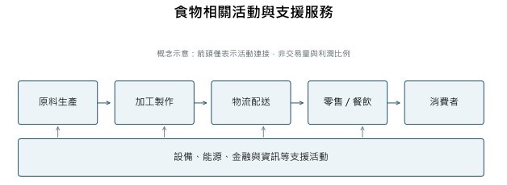
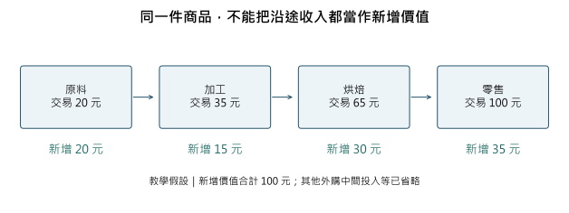
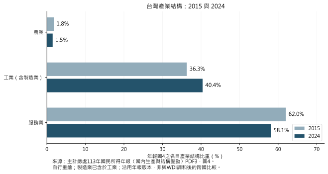

# 第 00 堂｜什麼是產業

學院導覽：何謂產業？SIC、NAICS、台灣行業統計分類、證交所分類的差異

> 教材候選稿。統計資料依文中所列年度與版本閱讀；本文尚非正式發布版本。

## 1　一份早餐，為什麼需要一張產業地圖？

先想像一個教學情境：早上出門，你在住家附近買了一份麵包和一杯飲料，以手機付款，再搭車上班。這裡沒有要描述某家真實店鋪，也不假定店家使用哪個品牌的原料。問題只是：這筆看似簡單的消費，究竟靠多少種經濟活動才能完成？

店員把商品交到你手上，是整段過程最容易看見的部分。但麵粉來自穀物加工，原料要經過種植、收穫、運輸與儲存。店裡需要烤爐、冰箱、照明與用水；手機付款需要設備、軟體與支付服務；商品若由工廠配送，還需要包裝、倉儲及送貨。消費者看到的是一份早餐，生產者面對的卻是一組相互依賴的活動。

如果只問「這家店叫什麼名字」，我們看見的是企業。如果問「有哪些業者從事相近的活動」，我們開始看見產業。如果問「早餐變貴時，人們會改買什麼」，問題又轉向市場與替代選擇。如果問「一份麵包怎麼從原料變成可購買的早餐」，便需要沿著價值鏈追查。

這些問法都合理，卻各自照亮不同的部分。產業研究的第一步，不是背下一串企業排名，而是知道自己正在問哪一種問題。分類可以幫助整理資料，但不能自動解釋競爭；公司財報可以告訴我們一家企業賺多少錢，卻不等於整個產業創造多少價值。

本課會從這份早餐出發，建立一套可以帶到其他課程的閱讀方法：先辨認企業與活動，再區分行業分類和產品市場；沿著價值鏈看分工、交易與風險；最後用全球與台灣的官方資料，理解不同產業在經濟體系中的位置。你不需要先懂會計或經濟學，遇到必要概念時，我們會把它拆開說明。

## 2　企業是一個組織，產業是一種觀察活動的方法

### 從招牌往裡看：公司不只有一件事

日常說話時，我們很容易把熟悉的公司名稱當成產業名稱。然而，一家企業可能擁有工廠、物流中心、門市和資訊部門，也可能同時銷售商品、出租空間或提供維修。這些活動在同一套管理體系裡，不表示它們具有相同的生產方式。

**企業（enterprise）**可以先理解為組織與管理經濟活動的單位；**場所單位（establishment）**則把目光拉近到具體的生產或服務地點。台灣行業統計分類以場所單位為基礎，觀察它主要做什麼。官方說明指出，一個企業可以包含多個場所，而這些場所從事的主要活動可能相同，也可能不同。這使統計不必把一整個多角化企業都壓成同一種活動。[^units]

想像一家食品企業另設配送中心與零售門市。這個例子不是在替任何真實企業指定分類碼，而是提醒讀者：要研究工廠勞動，與要研究門市服務，就不應只拿公司名稱當作觀察單位。實際統計如何處理配送、總部或企業內部輔助活動，仍要依各套分類的具體規則與資料編製方式判斷。

也不能把「企業」直接當成「品牌」。品牌是商品或服務被辨認的名稱；公司則涉及經營與法律組織。消費者熟悉的一個品牌，背後可能由不同地區的經營單位提供服務。反過來，同一企業也可能經營多個品牌。因此，看到一個名稱時，先問它代表品牌、公司、工廠、門店還是集團，比急著給它貼產業標籤更有用。

### 產業邊界取決於要回答的問題

本課將**產業（industry）**理解為：為了研究生產、交換與競爭，把具有相關活動、產品或服務的生產者放在一起觀察。這是一個分析用的工作定義。當目的是編製官方統計，邊界要依明確的分類制度；當目的是研究競爭，邊界還需要看顧客與供應商能否替代；當目的是理解一件產品如何完成，研究範圍又可能跨越好幾個官方行業。

例如，「半導體」可以是理解晶片設計、製造與封裝測試的教學主題；但要精確計算某項經濟活動，仍需說明究竟統計哪個環節。設計服務、工廠製造與設備供應，不能因為都和晶片有關，就不加區別地當成同一個資料欄位。同樣地，「食物」是一個生活主題，會跨越農業、食品製造、運輸、零售與餐飲。

這不是說產業沒有邊界，而是邊界必須說明理由。對一家麵包店而言，麵粉廠是供應者，鄰近早餐店可能是競爭者，提供貸款的銀行則是資金服務者。三者都影響店家，卻不是同一種關係。若把所有相關者統稱為「同一產業」，便失去區分供應、替代與融資的能力。

台灣現行分類也提醒我們，不宜只用營收判定所有活動。理論上，主要經濟活動以附加價值最大者判斷；拿不到這項資料時，才審慎使用產出或投入的替代指標。對商品買賣活動而言，買賣差價通常比整筆商品營業額更接近分類所需的產出概念。後面會解釋這個看似細微的差別，為何足以改變產業比較。[^principal]

### 同一個公司名稱，也需要時間與範圍

企業會擴張、分拆或調整業務。一份多年以前的公司分類，可以描述當時主要業務，不能直接保證今天完全相同。閱讀財報時也是如此：報告涵蓋的是母公司本身，還是包括子公司的合併範圍？期間是曆年，還是另一個結束日的會計年度？

這些問題不是專業人士才需要的細節。假如用一個跨國集團的全球營收，去代表它在台灣某一種活動的規模，就把公司邊界、地理邊界與行業邊界混在一起了。先把觀察對象說清楚，後面的故事與數字才不會彼此矛盾。

### 沒有公司招牌，也可能有需要理解的生產活動

到這裡，我們多用企業來說明，但整體經濟不等於公司名錄。世界銀行的服務業定義，包含公共行政、教育與醫療等活動；參與者不必全是上市公司，也不必以相同方式收費。理解一項服務，應先問提供了什麼、用了哪些資源，以及由誰支付成本，而不是只問經營者有沒有股票可以買。[^noncompany]

例如，若一項服務由公共機構提供，使用者當下支付的費用，就未必能單獨描述支撐服務的全部資源。若它由家庭成員自行完成，也不能直接套用收費企業的收入資料。這些區分會影響觀察對象與統計範圍，不能用「都沒有售價」把不同活動合成一類。

主計總處的國民所得概念說明，自給消費的農產品即使未經市場交易，也須估計生產價值；家庭內自給的育兒與家務服務，則不納入相同的生產與消費統計範圍。這表示統計有明確的生產邊界，不是只把所有收付款機械地加起來，也不是對每一項生活活動的重要性評分。討論照顧、食物或教育時，先說清楚統計包括哪些提供者，會比只比金額更接近真正的問題。[^productionboundary]

## 3　分類相同，不表示面對同一群顧客

### 產品市場從「會改買什麼」開始

再回到早餐。假設你原本打算買一杯咖啡，店家卻調高價格。你可能換一家咖啡店，也可能改喝茶，或決定在家沖泡。這些只是可能反應，不是已經觀察到的消費調查。它們揭示一個重要問題：什麼選擇，真的會對原供應者形成競爭壓力？

**產品市場（product market）**關心商品或服務之間的替代性。台灣公平交易委員會的處理原則，以功能、特性、用途或價格條件上的高度需求或供給替代性說明產品市場；並指出，需求替代是界定相關市場的主要考量。白話地說，就是交易相對人是否能夠、也願意轉向其他選擇。[^market]

因此，兩家業者即使有相同分類碼，也不保證其所有產品彼此密切競爭。它們可能服務不同用途、品質要求或顧客。反過來，官方分類不同的活動，也可能在某一項消費需求上互相替代。用一個共同的產業名稱宣布「大家都在同一個市場」，通常太快了。

但也不能走向另一個極端，把「都會花掉消費者的錢」當成充分理由，宣稱所有商品都在同一市場。早餐和度假都涉及支出，卻不能只因預算有限就認定兩者是直接替代品。替代關係有強弱，要依具體條件、轉換成本、使用情境與實際證據判斷。

### 距離、時間與轉換成本會改變競爭

**地理市場（geographic market）**則問：顧客可以在什麼區域內，容易地選擇或轉換交易對象？一項商品能運送很遠，不表示所有地區的供應者對每位顧客都形成相同壓力。運費、等待時間、維修便利性或法規，都可能影響選擇。公平會的原則明列運輸成本、取得便利性、交易成本與相關法規等考量，也允許視個案衡量時間因素。[^marketgeo]

假設早餐只剩十分鐘就要上班，另一個城市較便宜的麵包，未必是當下可行的替代選擇。若改成採購可長期儲存的原料，運輸距離的作用又不同。這是分析示例，不是在替某種早餐市場作法律認定。

**轉換成本（switching costs）**是更換交易對象或產品時付出的額外代價。它可以是學習新系統、重新檢驗品質、搬移資料所需的時間，也可以是合約與設備的配合成本。有替代品存在，不表示今天就能毫無代價地使用。分析競爭時，必須把「有沒有別人提供」與「現在能不能可靠地換過去」分開。

這也說明，市場占有率必須先有市場邊界。分母若是某地所有咖啡銷售，和分母若是所有早餐飲品，得到的比率不同。比率變了，不一定表示企業本身改變了；可能只是研究者改了觀察範圍。在討論一家企業是否強勢之前，先把產品、顧客、地區與期間寫出來。

## 4　為什麼世界需要不只一套產業分類？

### 分類制度是共同語言，也是一段歷史

如果各機關都自行決定什麼叫製造業、零售業或服務業，資料很難接在一起。就業統計的一個行業，可能和產出統計的同名行業範圍不同。分類制度的用處，就是讓調查、整理與比較有共同規則。它不是替所有研究問題預先寫好的答案，而是一套可反覆使用的統計語言。

聯合國的**國際標準行業分類（International Standard Industrial Classification of All Economic Activities, ISIC）**，最初版本於1948年採用，後來成為各國發展行業分類與跨國比較的重要參考。聯合國統計委員會於2023年認可第五次修訂。這表示國際分類框架向前更新，不表示每個國家、每張舊統計表都在同一天改用新制。[^isic]

美國的歷史提供另一個例子。2022年NAICS手冊追溯，1937年美國成立跨部會委員會，製造業與非製造業的行業清單分別於1938、1939年出現，形成早期的**標準產業分類（Standard Industrial Classification, SIC）**。SIC後來多次修訂，最後一次修訂為1987年。[^naicshistory]

當經濟活動改變，舊分類受到新的要求：如何描述新興服務？如何比較生產投入與產出？如何讓鄰近經濟體的資料更容易對照？**北美產業分類系統（North American Industry Classification System, NAICS）**便由美國、加拿大與墨西哥合作發展，美國統計於1997年首次使用。它以生產過程的相似性為重要組織原則，並定期檢視修訂。[^naicshistory]

因此，讀到SIC與NAICS時，不能只把前者叫「舊碼」、後者叫「新碼」就結束。某份歷史研究可能需要保留當時的SIC，才能忠實描述資料如何編製；較新的統計可能使用不同年份的NAICS。分類碼的用途與版本，和碼本身同樣重要。

### 台灣分類：從1967年試行到第12次修正

台灣於1967年參照國際分類及國情，公布試行行業統計分類；1971年第一次修訂後，層級擴充為大、中、小、細類。第12次修正主要參照ISIC第五次修訂、工業及服務業普查與國內產業發展，分為20個大類、88個中類、254個小類及530個細類，自2026年1月1日生效。[^twhistory]

層級的意義，可以想成逐步放大地圖。較大的類別讓我們看經濟結構，較細的類別讓我們辨認具體活動。放大地圖不一定讓每個研究問題都更準確；若資料品質不足，或研究對象本來跨越多個細類，最細的碼也可能給人不必要的精確感。

第12次修正對零售的一項調整，尤其容易理解：原則上不再以實體店面或非實體店面的銷售方式區分類別，而改依商品種類歸類，並保留零售攤販的特定架構。這反映「透過什麼通路賣」和「主要賣什麼」可以是不同的分類取向；它不表示網路銷售消失，也不表示線上與線下經營完全沒有差異。[^twretail]

分類改版會影響時間比較。假如某一類業者改歸別類，新版某行業的家數增加，就不能立即說成現實中突然多了這麼多企業。必須先看舊新分類對照，以及原資料是否已重新編製。相同碼在不同版本中，也可能包含不同內容。

### 證交所分類回答另一組問題

投資新聞中的產業標籤，常來自上市公司分類。台灣證券交易所的要點，是為股票初次上市公司劃分類別，以及在上市後業務性質變更時調整。2025年6月9日修正版列有半導體、食品、金融保險、數位雲端等33種類別；分類會考量營業收入與其他業務證據，並有定期調整規則。[^twse]

這套分類的觀察對象是上市公司，不是全國所有場所，更不是所有自營工作者、家庭企業與未上市公司。若用股市中的半導體公司市值，去代表台灣半導體的生產價值，就跨過了兩個沒有交代的步驟：從上市公司變成全體業者，以及從投資者評價變成當期生產。

下面的比較表不是分類碼互換表，而是提醒讀者先選對工具。

| 分類或觀察方式 | 主要用途 | 不宜直接推論的事 |

|---|---|---|

| ISIC | 組織經濟活動、協助國際統計比較 | 各國所有資料已採相同版本 |

| SIC | 理解採該制度編製的歷史或特定資料 | 舊碼可不經對照直接替換NAICS |

| NAICS | 北美經濟活動與生產關係的統計 | 所有細碼在三國都一對一可比 |

| 台灣行業統計分類 | 以主要經濟活動整理場所統計 | 分類碼自動決定所有行政管制 |

| 證交所上市公司分類 | 上市公司產業歸屬及調整 | 已涵蓋全國所有生產活動 |

| 相關市場分析 | 判斷具體競爭約束與替代範圍 | 行業碼相同就屬同一競爭市場 |

NAICS手冊也明示，北美三國能比較到的層級因行業而異，不是每個最細碼都能直接互換。台灣分類公告則特別區分統計用途與行政管理：若其他機關把分類用於管制，仍需依管理目的自行認定。這兩項提醒共同指出，資料標準有邊界，不能把它變成萬用規則。[^classificationlimits]

## 5　從一件產品走向價值鏈：誰做事、誰付錢、誰承擔風險？

### 把產品拆成活動，而不只拆成零件

**價值鏈（value chain）**描述一項商品或服務，從投入、製作、交付到使用所涉及的活動與關係。它不只是一張零件清單，也包括設計、協調、運輸、銷售及售後。追問價值鏈，是要看每個環節解決什麼問題，以及環節之間如何連接。

早餐的食物鏈可以畫成原料、加工、物流、零售或餐飲、消費者。但這張直線圖只是教學上的簡化。電力、金融、軟體和設備會同時支援多個環節；原料有時先經貿易商，有時直接採購；產品賣不掉，還可能形成報廢、退貨與回收。現實更像網絡，而不是只有一條從左到右的線。

圖1　概念示意，並非某品牌實際供應網絡，也未按交易量繪製。依活動邏輯及行業分類概念自行繪製。

讀這張圖時，至少要追三條線。第一條是商品或服務流：誰把什麼交給誰？第二條是付款與信用：誰先付錢，誰容許對方日後付款？第三條是資訊與責任：誰決定規格，誰回報需求，品質出問題時由誰處理？三條線未必同方向，也未必同時發生。

例如，在一個假設的食品訂單中，零售商先下單，工廠先購料生產，貨物交付後才收款。即使最終消費需求良好，工廠仍可能先承擔庫存與資金壓力。這說明「產品最後賣得出去」與「每個環節都能順利經營」不是同一件事；實際責任與現金流仍要看合約，不能由圖上的位置推斷。

### 真實例子：整合不等於全部自己擁有

Tyson的2024年度報告說明，其雞肉業務涵蓋育種、契約農戶、飼料生產、加工、行銷與運輸。這是一個可以具體看到多環節協調的企業例子。值得注意的是，報告同時列出契約農戶；因此，不能把「垂直整合的生產流程」解讀為每一個農場都由公司直接持有。[^tyson]

**垂直整合（vertical integration）**關心前後相接的活動如何被組織；產權、契約與管理控制，卻仍要逐一辨認。一家公司可以直接擁有某些環節，和另一部分參與者簽長期契約，也可能向外部市場採購。企業簡介裡的一個詞，不能取代具體的組織資料。

為什麼不讓所有活動都交給市場買賣？Coase在1937年的企業理論指出，尋找價格、協商及訂立契約本身有成本；把某些交易放進企業內部，可以改用組織協調。但內部管理也有成本，並非企業愈大、做得愈多就一定愈有效率。[^coase]

把這個想法放回早餐：若規格容易說清楚、供應者很多、檢驗簡單，透過交易可能相當方便。若每次修改產品都需要密切配合，或品質問題難以界定，持續合作、共同調整乃至內部化的價值可能提高。這是依理論推導的條件比較，不是宣稱某家店當初就是為了這個原因才自己烘焙。

### 分工之後，權力不一定平均分配

全球價值鏈研究進一步提醒，交易的複雜度、資訊能否清楚編碼，以及供應商能否達到要求，會影響企業如何協調。Gereffi、Humphrey與Sturgeon的研究提出不同治理形式，也強調同一產業不必只有一種關係，價值鏈並不沿著單一路線演進。[^gvc]

用白話說，「把工作交出去」不是一種固定的安排。買標準品，與共同開發一個難以寫成規格的新產品，需要的互動不同；能獨立完成複雜任務的供應者，與只能執行少數指定步驟的供應者，面對的依賴也不同。

因此，身處同一條鏈不表示所有人同時獲利，也不表示最上游或最下游必然最強。若要判斷誰能議價，還要看替代選擇、技術與品質能力、容量、規格控制及轉換成本。價值鏈圖的箭頭告訴我們活動如何連接，不能單靠箭頭讀出利潤分配。

## 6　產業有多大？先問數字量的是什麼

### 一份商品不能沿途重複算成全部新價值

一家店的收入很直覺：賣出商品，收到款項。但把所有企業的收入加總，並不能直接得到整個經濟新創造的價值，因為同一份原料可能在不同交易中反覆出現。

下面是一個完全假設的例子，金額不是任何產業的實際成本。假設原料生產者以20元出售原料，加工者以35元出售加工品，烘焙者以65元賣出麵包，零售者最後以100元賣給消費者。為了單獨說明重複計算，暫時假設除了鏈上向前一環節購買的投入，沒有其他外購中間投入、進口與稅額調整。

如果把20、35、65、100全部相加，得到220元。但顧客買到的最終商品只有100元；中間投入的價值已包含在後續售價裡。各環節新增的部分，依次是20、15、30與35元，合計才是100元。前三個生產環節以售價說明產出；最後一個環節是轉售商品，100元是商品銷售額，零售服務的產出則以35元買賣差價觀察。在本例沒有其他外購中間投入的假設下，這35元也是零售環節的附加價值。因此，下圖將沿途金額標成「交易金額」，不把零售整筆營收叫作零售產出。

**附加價值（value added）**就是產出價值減去中間消費。主計總處的國民所得基本概念，以棉紗加工成棉布解釋同樣的道理：投入原料的價值不能全部當成本環節新創造的價值。這裡的「附加」不是廣告上的高級感，也不是公司淨利，而是會計上的生產貢獻。[^valueadded]

圖2　教學假設，單位為元；20、35、65、100是各階段商品交易金額，20、15、30、35是各環節附加價值。並非真實麵包價格或毛利調查。原理參照主計總處國民所得年報附錄一。

附加價值之中，還要支持受僱者報酬、資產使用與其他所得項目；不能直接視為老闆最後帶走的利潤。真實零售者還會使用電力、外部配送等投入，所以100元售價減65元進貨的35元，也不能不作其他調整就當成實際零售附加價值。假設的功能是拆出一個概念，而不是替現實經營下結論。

**國內生產毛額（Gross Domestic Product, GDP）**描述一段期間內經濟領域的生產成果。由生產面理解時，關鍵是各活動新增的價值，而不是把每次商品轉手的金額全算一次；完整帳表還需依編製規則處理估價、稅額與統計差異。**國民經濟會計制度（System of National Accounts, SNA）**則提供生產、所得與支出相互連接的架構。[^accounts]

### 零售營業額與零售附加價值有不同用途

經濟部在2025年1月23日發布的2024年統計，列出台灣零售業全年營業額4兆8,530億元。同份資料也列出全年網路銷售額6,533億元，占零售業營收13.5%。這些數字有助理解交易規模與銷售方式，但營業額不是零售業的附加價值。[^retaildata]

網路銷售也不等於「只有電子購物公司賣出的商品」。有店面的業者也能接受線上訂單。同樣地，消費者在線上付款，並不自動把原本從事商品零售的活動變成軟體業。通路、付款技術與主要經濟活動，是需要分開觀察的面向。

這組統計依當時第11次行業分類發布，本文保留其版本，不能把它改標成2026年新制數字。未來若看到不同的2024年總額，先查是否有回溯修訂或範圍變動，不宜先認定其中一個數字一定錯誤。

### 比較之前，替每個數字補上身分

**產能（production capacity）**是生產能力的描述；實際產量是某段時間完成多少。**出口（exports）**在貨物貿易統計中描述對外貨物流動，國民經濟會計另依常住性、所有權等原則調整；企業營收是報告範圍內的收入；**市值（market capitalization）**則是特定時點股價與股數形成的市場評價。它們可以都很重要，卻沒有理由被當作同一種「產業規模」。

存量與流量也必須分開。年底銀行持有多少資產，是時點的存量；一家企業一年取得多少收入，是期間的流量。只因兩者都用貨幣表達，就把它們放在同一張「誰比較大」的排名裡，會失去經濟意義。

貨幣金額還要問價格。**名目值（nominal value）**使用當期價格；**實質值（real value）**則試圖排除價格變動，以觀察數量或生產的變化。收入上升可能來自售價、銷量、產品組合或報告範圍變化，不能只看到金額增加，就說技術進步或生活品質提高。[^prices]

最實用的習慣，是替每個重要數字補上六項身分：誰編製、哪一年、哪裡、什麼活動、什麼單位、哪個版本。若還要比較企業，再加上個體或合併、會計年度及報告準則。這些身分不是附屬小字，而是數字的意義本身。

## 7　全球與台灣：服務業比重大，製造業仍然關鍵

### 先看世界，再問世界平均遮住了什麼

世界銀行的世界發展指標（World Development Indicators, WDI），提供按活動區分的附加價值占GDP比率。在2026年10月8日更新版本中，2024年世界彙總的農林漁業約為4.1%、工業約25.4%、服務業約63.3%。這裡的工業包括營造，也包括製造、採礦及公用事業，不能把25.4%直接改稱製造業比重。[^wdi]

這三個世界彙總指標加起來並不是100%。不要為了畫出完整圓餅，就把剩餘部分命名成一個未被來源定義的「其他產業」，也不要自行把三者重新正規化。國際資料有不同估價、編製與涵蓋問題，世界彙總還需要處理各經濟體資料。本課保留原指標，使用分開的數值表，而不把它包裝成已完整調和的世界帳表。

| 2024年WDI世界彙總指標 | 占GDP比率，約數 |

|---|---:|

| 農業、林業與漁業附加價值 | 4.1% |

| 工業附加價值，含營造 | 25.4% |

| 服務業附加價值 | 63.3% |

這是全球大局的入口，不是所有國家的共同樣貌。世界彙總並不代表每個經濟體都由相同比例的活動構成，也不提供「哪一種結構一定最好」的答案。產業占比還會受到價格、國際分工、人口、資源與制度等條件影響。要解釋結構差異，還需對具體地區追查，而不是用一個比率替所有國家排發展階段。

### 台灣的製造與服務，同時存在於一套生產網絡

主計總處《113年國民所得統計年報》的產業結構圖，列出2024年農業1.5%、工業40.4%、服務業58.1%；其中製造業35.7%，是工業的一部分，不能再與工業相加。同一份圖表中的2015年比重，分別為農業1.8%、工業36.3%、服務業62.0%。本文沿用該年報版本與圖表定義，不冒稱後續修訂後的最新值。[^twstructure]

圖3　依主計總處113年國民所得年報〈國內生產與結構變動〉圖4自行重繪；名目生產毛額的產業結構比重，單位%。製造業包含在工業中；四捨五入可能影響加總。這張圖與WDI世界指標的編製及彙總基礎不同，不作未調和的精確百分點比較。

從這組台灣資料，可以同時看見兩件事：服務活動占有很大位置，製造活動也構成重要的生產基礎。「服務業大」不表示不需要工廠；「製造業強」也不表示物流、金融、資訊與商業服務只是附屬品。工廠需要設備維修、研發、運輸與資金，服務企業也需要建物、機器與數位設備。

這些關係讓「產業升級就是從製造改做服務」成為過度簡化的敘述。企業可能改善製程，也可能增加設計、維修或軟體服務；新的服務可以支持製造活動，製造活動也可以創造服務需求。是否提高附加價值、改善工作或形成可持續的能力，需要分別觀察，不能只看名稱從哪一類改到哪一類。

占比下降也不必然表示產出減少。假設一項活動的名目生產從100增加到110，而其他活動成長更快，它的占比仍可能下降。這是一個比例的邏輯例子，不是台灣某年的實際數據。判斷衰退，必須再看絕對金額、價格調整後的變化、就業與企業情況，不能把一張結構圖當成完整診斷。

### 看見分類以外的生活重要性

農業的附加價值比重較小，不表示食物供應不重要。農產品還會連接加工、運輸、餐飲與零售；這些後續活動在分類上通常不全留在農業。若研究的問題是食物如何送上餐桌，就需要跨分類追蹤。若問題是農場本身的生產，範圍則應保持清楚。

同樣地，一項活動在GDP中占比大，不表示每位工作者都獲得高收入；占比小，也不表示社會可以輕易失去它。統計描述的是特定規則下的經濟量，不能單獨替代安全、韌性、環境與分配問題的判斷。理解產業結構，是把問題問得更準確，而不是讓一個數字決定所有重要性。

## 8　產業為何不同：從生產條件推回成本與競爭

### 規模不是只看公司大不大

不同活動需要不同的投入與時間。有些工作依賴設備，有些依賴專業人力；有些可以先做成庫存，有些需要顧客到場；有些產品可以遠距交付，有些需要在地設施。這些條件會改變成本與經營方式。以下是有條件的分析例子，不是把每一種產業永久分成兩類。

**固定成本（fixed cost）**是在指定期間與產量範圍內，不隨產出直接同比變動的成本；**變動成本（variable cost）**則會隨生產活動改變。時間範圍很重要：短期租約可能暫時固定，較長期間卻可以重新選址或調整規模；同一項支出不能不看條件就永遠稱為固定。

假設一套設備在安全及品質條件相同時，可以把初期投入分攤到更多合格產品，平均成本便可能下降。**規模經濟（economies of scale）**指的就是規模擴大可能降低平均成本的關係，而不是「大公司必然賺錢」。若訂單不足、管理複雜、運輸距離拉長或設備閒置，擴大規模也可能增加負擔。

對餐飲或醫療等需要特定時段交付的服務而言，沒有使用的時段通常不能像一箱包裝商品那樣留到隔天出售；但這也不代表所有服務都不能儲存或重複交付。軟體、預錄內容與某些資料服務具有不同的交付條件。分析時應說明哪個環節、哪種服務，而不是只用「服務業」三個字推論成本。

農業也不能只用「靠天吃飯」概括。不同作物、養殖或畜牧活動，對生長週期、環境控制與投入的依賴不同。若生產需要生物成長時間，增加投入通常不能讓所有產品立刻提前成熟；若設施可以改善環境條件，也不表示自然風險全部消失。這些是理解生產限制的方向，具體效果仍需各產業資料。

### 設備、人力與制度，可能形成不同的進入條件

**進入障礙（barriers to entry）**是新參與者不易進入或形成有效競爭的條件。它可能涉及資金、技術、許可、客戶認證與服務網絡。不能只因創業花錢，就宣稱一個市場存在不可逾越的障礙；也不能只因有人新成立公司，就認定它已經能以同樣品質與規模競爭。

想像兩種假設活動：一種可以用通用設備、小量試做並逐步找到顧客；另一種必須在接單前完成昂貴設備與長期驗證。兩者的新進者面對不同風險。前者也許容易開始，卻可能很難維持差異；後者也許需要較長準備期，但最終表現仍取決於需求、技術與組織能力。

競爭也不只發生在售價。顧客可能在意準時交貨、可靠度、維修、資訊安全或使用便利。若只能看見最低價，就會忽略產品真正被選擇的理由。但我們也不能反過來，單憑公司聲稱「品質好」，便認定它具有持續競爭優勢；需要可比較的品質、成本與交易證據。

制度則會改變可行的交易方式。食品安全、金融監理、專業資格與環境規範，各自處理不同問題；同一分類碼不能取代主管機關對實際活動的認定。規範可能要求額外投入，也可能建立交易信任。若要解釋一項規範的實際效果，仍須看適用範圍、執行方式與企業反應，不能只把它叫作「限制」或「保護」。[^classificationlimits]

### 數位化讓邊界移動，卻沒有讓分類失去用途

當零售商加入線上訂購、製造商提供遠端維修，原本的活動會增加新的連接方式。這時應問：主要產出改變了嗎？新增的是銷售方式、支援工具，還是一項可以獨立提供的服務？答案不同，分類與分析的處理也可能不同。

台灣第12次分類特別舉例，某些免費線上服務以廣告取得營收，若只看錢從哪裡來，就可能把主要活動錯判成廣告服務。官方因而提醒，在這類情況要考量人力、資本等投入。這個例子說明，分類判斷需要理解活動本身，不能只看收入項目的名稱。[^platform]

公平會對**多邊市場（multi-sided market）**的說明，則關心平台如何促進不同用戶群體互動，以及一群使用者如何影響另一群使用者取得的價值。這和「提供線上服務就屬哪一類」是不同問題。統計分類與競爭分析各有用途，數位化反而讓區分兩者更重要。[^platformmarket]

## 9　兩個企業窗口：台積電與Walmart，如何幫助我們看見產業？

### 台積電：把製造本身變成對外提供的服務

台積電的1998年原始年報介紹，公司於1987年在新竹成立，以專業晶圓製造為定位。這份歷史文件還說明，公司章程限制設計製造自有品牌積體電路，並以成為客戶的合作夥伴、而非自有品牌競爭者描述自身角色。這是當時公司對組織定位的說明，不能擴張成所有代工企業共同的法律規則。[^tsmc]

**積體電路（integrated circuit, IC）**可以先理解為把電路功能整合在晶片上的產品；本課不需要先學會電路設計，但要分清楚「決定電路如何運作」與「把設計製造成可使用的晶片」是不同任務。所謂**專業晶圓代工（dedicated semiconductor foundry）**，就是以製造能力服務其他晶片設計需求的組織方式。台積電的歷史文件，提供了這種分工的具體窗口。

這個安排讓我們看見：一家企業沒有把一件最終產品從頭做到尾，仍可能在其中一個環節扮演重要角色。專業製造需要設備、製程與品質協調；客戶則有其產品與設計需求。要讓分工運作，不能只有一份訂單，還需要技術資訊、進度與品質要求能被雙方理解和執行。

1998年年報列出，當年底公司有兩座六吋、三座八吋晶圓廠，年產能約160萬片八吋約當晶圓；同年年中，WaferTech開始量產。這些資訊能說明當時製造布局與能力的規模，卻不能把產能當實際出貨，更不能直接接上今天的市場排名。[^tsmccapacity]

「約當」也是閱讀產業數據的重要提示。不同尺寸的晶圓，不能只拿片數直接相加。標準化單位讓比較有可能，但仍要看換算方式。這和分類碼的道理相近：共同單位提供比較基礎，不會消除所有產品與技術差異。

從這個故事可以提出一個有根據的理解：企業邊界可以圍繞一項專業活動形成，並透過跨企業協調參與更長的價值鏈。但不能只憑公司後來發展，就斷言這種模式在所有時期都比整合經營更有效，也不能把成立年份當作成功原因。要解釋後來的表現，還需要技術、客戶、資本與競爭等更完整的證據。

### Walmart：門店形式改變，也改變活動的組合

Walmart官方歷史記載，第一家店於1962年在美國Arkansas州Rogers開幕；1983年開出第一家Sam’s Club；1988年在Missouri州Washington開出首家Supercenter，把一般商品與完整超市結合；1991年透過與Cifra合作進入墨西哥。這幾個節點顯示，企業成長可以同時涉及業態、商品組合與跨國經營。[^walmart]

這裡最值得學習的，不是把年份背起來，而是辨認問題怎麼變了。綜合商品與食品放在同一個購物場所，可能讓顧客一次完成更多採買；也會讓經營者面對不同商品的補貨、保存與需求條件。這是活動組合所帶出的分析問題，不是已證明某一事件造成營收成長的因果估計。

Walmart的2024年度報告，涵蓋截至2024年1月31日的會計年度，列出總營收648,125百萬美元、淨銷售642,637百萬美元。兩者不同，是因為總營收還包含會員及其他收益。報告同頁列出營業利益27,012百萬美元。這三個數字分別回答收入範圍與經營結果，不能互相替代。[^walmartfinancial]

也不能拿這個全球企業的營收，直接和台灣零售業的附加價值比較。前者是企業合併報告的收入，後者是特定經濟領域活動的新增價值；地理、期間、幣別與會計概念也不同。先前的分類、邊界與統計概念，在這裡連成了同一個閱讀動作。

這兩個企業案例刻意呈現不同的活動：一個是製造分工，一個是零售交付。它們都提醒我們，企業故事有用，是因為故事能打開產業問題；不是因為一家著名公司的經歷足以代表所有供應商、新進者與退出者。理解產業，還要持續追問那些沒有出現在成功故事中的參與者。

## 10　把產業當成一組可以追問的關係

現在再看最初的早餐。你可以辨認提供原料、生產設備、加工、運輸、零售、支付與能源的不同活動；也知道同一企業可能跨越多個環節，同一行業裡可能有不同市場，而一條食物鏈又會跨過多種官方分類。

讀到「某產業成長」時，先問成長的是產量、營收、實質附加價值，還是股市評價。讀到「某企業很強」時，先問強在哪種產品、哪個地區、哪段期間，以及它和供應者、顧客的關係。讀到「台灣需要轉型」時，則追問改變的是活動組合、技術、需求、制度還是價值分配。

分類制度讓我們能整理經濟活動；市場分析幫助辨認替代與競爭；價值鏈呈現分工與協調；統計則用有明確範圍的數字描述規模與變化。把這幾種工具接起來，產業便不再只是新聞裡的標籤，而成為可以觀察、比較與逐步理解的生產世界。

### 理解問題

1. 一家企業擁有工廠與門市時，研究企業營運和研究各地零售活動，為什麼可能需要不同統計單位？

2. 兩種商品有相同的行業分類，為什麼仍不能直接認定屬於同一產品市場？反方向又可能如何發生？

3. 為什麼不能把價值鏈所有企業的營收直接加總，當作整條鏈對GDP的貢獻？

4. 某產業占比下降時，還需要哪些資料才能判斷它是否真的衰退？

5. 台積電與Walmart各自幫助我們理解什麼產業問題？它們的歷史又不能支持哪些因果結論？

### 產業情境：早餐店增加網路訂購

以下是假設情境，並非真實公司的決策紀錄。一家早餐店原本由顧客到店購買，現在增加線上預訂，並委託外部配送。請分別畫出商品、付款與資訊的流向，再回答：主要生產活動是否必然改變？多出哪些合作對象與成本？如果顧客覺得配送費太高，可能轉向哪些選擇？需要什麼資料，才能判斷實際市場邊界？

這個情境不要求唯一的分類答案。好的回答應先交代店家實際做什麼、資料要衡量什麼，再說明哪些部分仍需依正式分類或交易證據判斷。

### 重要術語

| 中文 | 英文 | 本課用法 |

|---|---|---|

| 產業 | Industry | 依研究目的，把相關生產活動或生產者放在一起觀察。 |

| 企業 | Enterprise | 組織經濟活動的單位，可能包含多個場所與業務。 |

| 場所單位 | Establishment | 在具體地點觀察主要生產活動的統計單位。 |

| 產品市場 | Product market | 依具體替代關係辨認商品或服務的競爭範圍。 |

| 地理市場 | Geographic market | 顧客容易選擇或轉換交易對象的區域範圍。 |

| 價值鏈 | Value chain | 從投入到交付與使用的活動及連接關係。 |

| 垂直整合 | Vertical integration | 前後相接活動的組織安排；需分辨產權與契約。 |

| 附加價值 | Value added | 產出價值扣除中間消費，並非公司淨利。 |

| 固定／變動成本 | Fixed / variable cost | 依指定期間與產出範圍，區分成本的變動關係。 |

| 規模經濟 | Economies of scale | 在特定條件下，擴大規模可降低平均成本。 |

| 轉換成本 | Switching costs | 更換供應者或產品所需的額外時間、資源與代價。 |

| 名目／實質值 | Nominal / real value | 使用當期價格／排除價格變動後的觀察方式。 |

### 相關課程

依原課綱，可接續第01堂〈產業如何賺錢〉、第02堂全球價值鏈、第03堂產業競爭與第04堂產業研究方法；也可直接選讀第05堂農業、第18堂半導體或第30堂零售相關主題。這些是課綱上的閱讀方向，不表示各課已正式發布，無須先完成其他課才能理解本課。

## 原始來源與註記

[^noncompany]: World Bank，WDI服務業指標定義，ISIC Rev.4第45–99類所涵蓋活動包括公共行政、教育、醫療等。[官方定義](https://databank.worldbank.org/metadataglossary/world-development-indicators/series/NV.SRV.TOTL.ZS)。
[^productionboundary]: 行政院主計總處，《113年國民所得統計年報》，附錄一，印刷p.95／分檔PDF2，「國民所得統計之範圍」。
[^units]: 行政院主計總處，《行業統計分類》第12次修正，說明「統計單位」，印刷pp.2–3／PDF7–8。[官方全文](https://ws.dgbas.gov.tw/001/Upload/463/ebook/ebook_356166/pdf/full.pdf)。

[^principal]: 同上，說明「行業判定原則」，印刷pp.3–4／PDF8–9。主要活動、替代指標與限制均須一併閱讀。

[^market]: 公平交易委員會（2023年11月22日修正），《對於相關市場界定之處理原則》，第2、3、4、7點。[現行規範](https://law.ftc.gov.tw/law/LawContent.aspx?id=GL000242)。

[^marketgeo]: 同上，第2、3、5點；本文飲料與早餐例均為教學假設，非個案市場認定。

[^isic]: United Nations Statistics Division，ISIC官方介紹與Revision5說明；1948年起源、2023年認可，2026年11月6日核讀。[官方說明](https://unstats.un.org/unsd/classifications/Econ/isic)。

[^naicshistory]: Executive Office of the President, Office of Management and Budget（2022），*North American Industry Classification System, United States, 2022*，印刷pp.13–14／PDF15–16。[官方手冊](https://www.census.gov/naics/reference_files_tools/2022_NAICS_Manual.pdf)。

[^twhistory]: 行政院主計總處，第12次行業分類，行政院2025年12月12日函／PDF4；前言印刷p.1／PDF6。資料年與生效日不相同。

[^twretail]: 同上，分類原則，印刷p.2／PDF7，第4項。

[^twse]: 臺灣證券交易所（2025年6月9日修正），《上市公司產業類別劃分暨調整要點》，第1–5點。[官方全文](https://twse-regulation.twse.com.tw/TW/law/DAT0201.aspx?FLCODE=FL007104)。

[^classificationlimits]: NAICS2022手冊，印刷p.4／PDF6；台灣第12次分類，PDF4、印刷pp.1–2／PDF6–7。前者說明跨國可比層級的限制，後者區分統計與行政用途。

[^tyson]: Tyson Foods, Inc.（2024），*Form10-K, fiscal year ended September28,2024*，Item1 Business，印刷p.3／PDF4。[原始年報](https://s203.q4cdn.com/483587180/files/doc_financials/2024/q4/TSN-FY2024-10K.pdf)。

[^coase]: Coase, R. H.（1937）。“The Nature of the Firm.” *Economica*,4(16),386–405，特別是pp.388–394。[DOI](https://doi.org/10.1111/j.1468-0335.1937.tb00002.x)。這是理論推導，並非本課例子的因果估計。

[^gvc]: Gereffi, G., Humphrey, J., & Sturgeon, T.（2005）。“The Governance of Global Value Chains.” *Review of International Political Economy*,12(1),78–104，pp.83–87、97–99。[DOI](https://doi.org/10.1080/09692290500049805)。

[^valueadded]: 行政院主計總處，《113年國民所得統計年報》，附錄一「國民所得基本概念及重要名詞解釋」，印刷pp.95–96／分檔PDF2–3。[官方附錄](https://ws.dgbas.gov.tw/001/Upload/463/relfile/11025/235627/%E9%99%84%E9%8C%84%E4%B8%80.pdf)。

[^prices]: World Bank，NY.GDP.MKTP.CD指標官方metadata，sourceNote說明當期價格未排除跨期價格變動。[官方定義](https://api.worldbank.org/v2/indicator/NY.GDP.MKTP.CD?format=json)。
[^accounts]: 同上，印刷pp.94–96／分檔PDF1–3；本註支持國民經濟會計架構與附加價值概念。本文假設例已省略完整國民經濟會計調整。

[^retaildata]: 經濟部統計處（2025年1月23日），〈113年12月批發、零售及餐飲業營業額統計〉，PDF2–3，表2、表3；依第11次分類發布。[原始發布檔](https://www.moea.gov.tw/Mns/populace/news/wHandNews_File.ashx?file_id=119727)。

[^wdi]: World Bank，WDI，2024年世界彙總，2026-10-08版本；NV.AGR.TOTL.ZS、NV.IND.TOTL.ZS、NV.SRV.TOTL.ZS。[農林漁業資料](https://api.worldbank.org/v2/country/WLD/indicator/NV.AGR.TOTL.ZS?date=2024&format=json)、[工業定義](https://databank.worldbank.org/metadataglossary/world-development-indicators/series/NV.IND.TOTL.ZS)、[服務業定義](https://databank.worldbank.org/metadataglossary/world-development-indicators/series/NV.SRV.TOTL.ZS)。未重新正規化為100%。**待核對：三個世界彙總系列加總差額的估價與涵蓋分解尚未完成；因此不將它們畫成完整組成圖，也不據此做精確跨國差距排名。**

[^twstructure]: 行政院主計總處，《113年國民所得統計年報》，〈國內生產與結構變動〉，分檔PDF3，圖4及產業結構段落。[官方原文](https://ws.dgbas.gov.tw/001/Upload/463/relfile/11025/235627/1-2.pdf)。

[^platform]: 行政院主計總處，第12次行業分類，印刷p.4／PDF9，「投入替代指標」與免費線上服務例。

[^platformmarket]: 公平交易委員會（2023），前引處理原則，第2點第6–7款、第4點第4款。

[^tsmc]: Taiwan Semiconductor Manufacturing Company，*1998 Annual Report*, “Company Profile”，成立、章程與專業代工段。[當年原始年報](https://investor.tsmc.com/static/annualReports/1998/html/intro.htm)。1998為資料年度；該HTML未明載獨立出版日期。

[^tsmccapacity]: 同上，晶圓廠產能與WaferTech段；160萬片為年產能、八吋約當單位，不是實際出貨量。

[^walmart]: Walmart，官方歷史時間線1962、1983、1988、1991項，2026年11月6日核讀。[歷史時間線](https://corporate.walmart.com/about/history)。公司自述可支持事件，不單獨證明成功機制。

[^walmartfinancial]: Walmart Inc.（2024），*2024 Annual Report*，印刷p.41／PDF43，Consolidated Results of Operations。[原始年報](https://stock.walmart.com/_assets/_8c8425b76a1d46bbbbc16466da2a6b9c/walmart/db/950/9651/annual_report/Walmart+2024+Annual+Report.pdf)。期間截至2024年1月31日，單位百萬美元。
